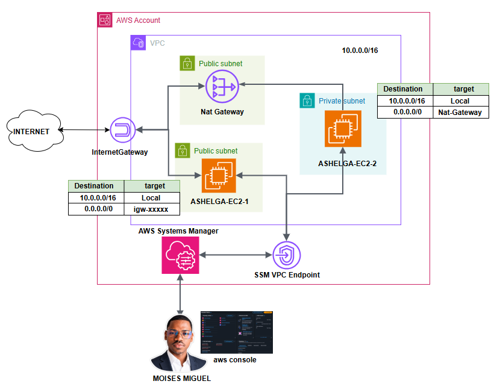

# Project: Building a Network and Deploying AWS Systems Manager (SSM)

This project creates a complete AWS networking foundation and integrates it with AWS Systems Manager for secure EC2 instance management. It combines VPC design, subnets, routing, NAT gateways, security groups, VPC endpoints, and SSM configuration in a modular Terraform setup.

<p align="center">
  
</p>

## Overview

The project includes:

- A custom VPC with DNS support enabled
- Public and private subnets
- Internet Gateway and NAT Gateway configuration
- Security groups for EC2 and VPC endpoints
- VPC interface endpoints for SSM services
- IAM role and SSM default management configuration
- EC2 instances deployed in the private/public network plane

## Infrastructure Deployed

- `aws_vpc` for the main network
- Public and private subnets
- NAT gateways and route tables
- `aws_vpc_endpoint` resources for SSM and SSMMessages
- AWS security groups and rules
- `aws_iam_role` and `aws_ssm_service_setting` for SSM integration
- EC2 instances created from reusable module logic

## Modules Used

- `module/vpc` — network layer creation
- `module/ssm` — SSM IAM role and service settings
- `module/ec2` — EC2 instance provisioning logic

## Key Files

- `main.tf` — main VPC, SSM, EC2, and endpoint configuration
- `variables.tf` — region and VPC endpoint list inputs
- `provider.tf` — AWS provider setup
- `module/vpc/main.tf` — VPC and routing resources
- `module/vpc/outputs.tf` — VPC outputs used by parent module
- `module/ssm/main.tf` — IAM role and SSM service configuration
- `module/ec2/main.tf` — EC2 instance creation based on a reusable template

## Security and Communication Design

The architecture is designed to allow EC2 instances to communicate with AWS Systems Manager through VPC interface endpoints rather than exposing direct public access for management traffic. This pattern is a common best practice for secure, private connectivity in AWS environments.

## Variables

- `aws_region`: target deployment region, default `ap-south-1`
- `vpc_endpoints`: list of VPC endpoints to create, default `ssm` and `ssmmessages`

## Usage

```bash
terraform init
terraform plan
terraform apply
```

## Notes

This is a more advanced Terraform project that combines networking, security, IAM, and AWS Systems Manager into a realistic cloud deployment pattern. It is helpful for learning infrastructure segmentation, managed instance access, and private service communication patterns.
