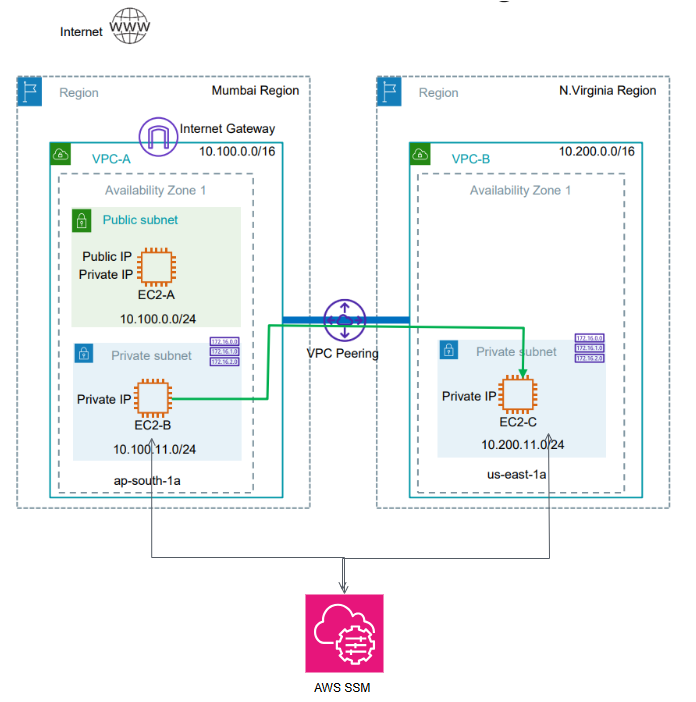
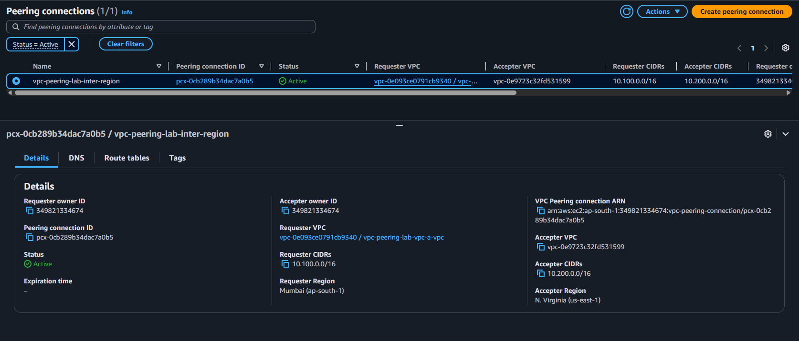

# 6.1 - Inter-region VPC Peering with public/private subnets and AWS SSM access

### Network Topology
<p align="center">
  
</p>

- VPC-A has an Internet Gateway; EC2-A sits in the public subnet.
- Inter-region VPC peering between VPC-A and VPC-B.
- Peering routes connect the **private subnet of VPC-A** and the **private subnet of VPC-B**, so EC2-B <-> EC2-C works (green arrow in the diagram).
- EC2-A (public subnet) has no peering route, so it cannot reach VPC-B.

## SSM access (no SSH, no key pairs, no bastion)
- One IAM role with `AmazonSSMManagedInstanceCore` + instance profile, attached to all 3 instances.
- Each VPC has `ssm`, `ssmmessages` and `ec2messages` interface VPC endpoints (private DNS enabled) in the private subnet, so EC2-B and EC2-C register in SSM without NAT or internet.
- EC2-A also uses the endpoints (same VPC), and could reach SSM over the Internet Gateway as well.
- Instances use Amazon Linux 2023 (SSM Agent preinstalled) with IMDSv2 enforced.

## Structure
```
├── main.tf / provider.tf / variables.tf / output.tf
└── module/
    ├── vpc/   (VPC, public/private subnets, IGW, route tables, SSM endpoints)
    ├── ec2/   (instance + security group)
    └── ssm/   (IAM role + instance profile)
```

## Prerequisites
- Terraform >= 1.5 and AWS credentials with permissions for EC2, VPC, IAM and SSM.
- AWS CLI + Session Manager plugin installed locally.

## Usage
```bash
terraform init
terraform plan
terraform apply
```

## Testing
Wait 2-3 minutes after `apply` so the SSM Agent can register, then:
```bash
# 1. check the 3 instances are registered in SSM
aws ssm describe-instance-information --region ap-south-1 --query "InstanceInformationList[].InstanceId"
aws ssm describe-instance-information --region us-east-1  --query "InstanceInformationList[].InstanceId"

# 2. open a session on EC2-B (see the ssm_connect_commands output)
aws ssm start-session --target <ec2-b-id> --region ap-south-1

# 3. inside EC2-B
ping <EC2-C private IP>      # works over the peering
```
## Screenshots

### Terraform Outputs
<p align="center">
  
</p>

### EC2 Connectivity — Northern Virginia
<p align="center">
  
</p>

### EC2 Connectivity — Mumbai
<p align="center">
  
</p>

### VPC Peering Verification
<p align="center">
  
</p>

<p align="center">
  
</p>

## Cleanup
```bash
terraform destroy
```
