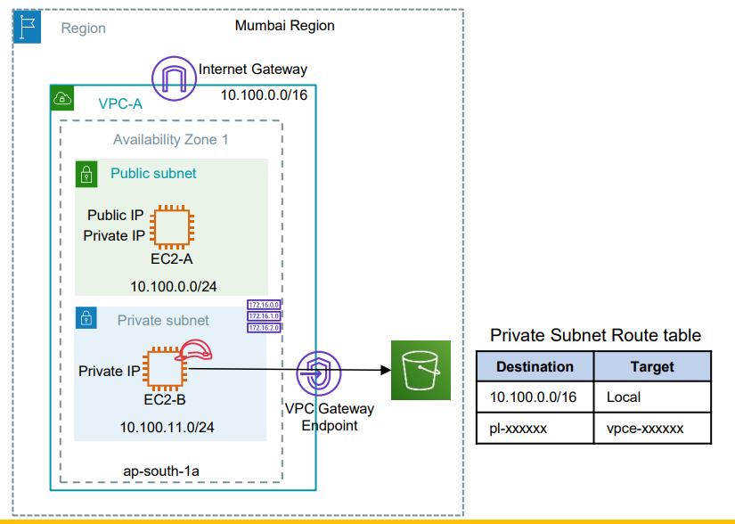
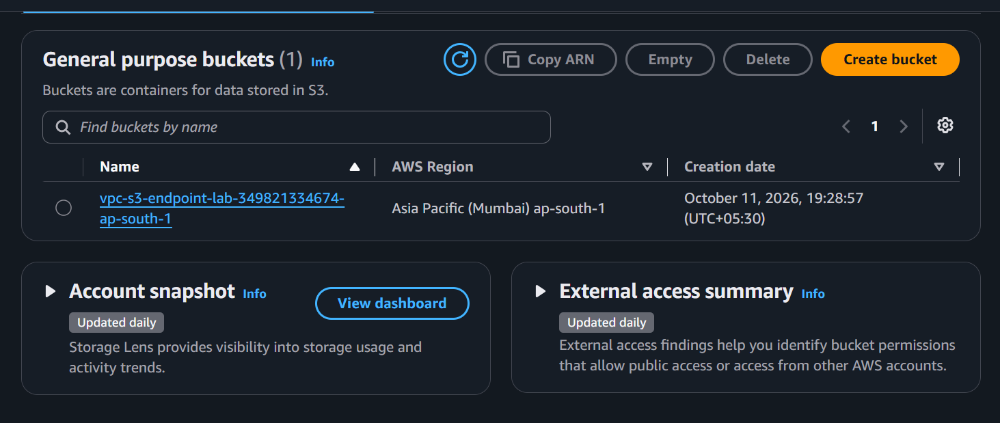
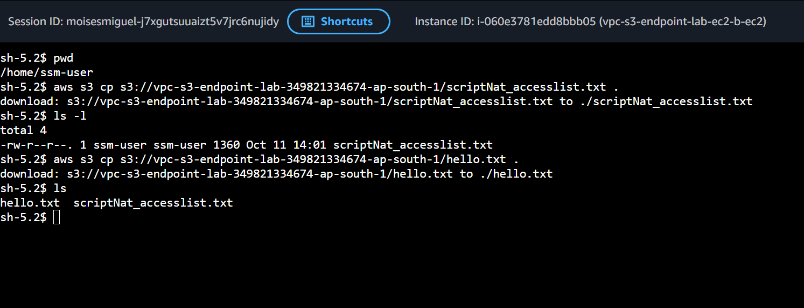

# 6.3 - VPC Gateway Endpoint for S3 (with AWS SSM access)

## Architecture
<p align="center">
  
</p>

- VPC-A has an Internet Gateway; EC2-A sits in the public subnet.
- The private subnet has **no Internet Gateway route and no NAT Gateway**.
- An **S3 Gateway Endpoint** is attached to the private route table. AWS adds the route automatically:

| Destination | Target |
|-------------|--------|
| 10.100.0.0/16 | local |
| pl-xxxxxx (S3 prefix list) | vpce-xxxxxx |

- EC2-B reaches S3 privately through the endpoint (traffic never leaves the AWS network).
- A private S3 bucket (public access blocked, SSE-S3) with a `hello.txt` test object is created. The instance role can list/read/write **only this bucket**.

## SSM access (no SSH, no key pairs, no bastion)
- One IAM role with `AmazonSSMManagedInstanceCore` + instance profile, attached to both instances.
- `ssm`, `ssmmessages` and `ec2messages` **interface** VPC endpoints (private DNS enabled) in the private subnet, so EC2-B registers in SSM without NAT or internet.
- Instances use Amazon Linux 2023 (SSM Agent and AWS CLI preinstalled) with IMDSv2 enforced.

## Gateway vs Interface endpoints
- **Gateway endpoint** (S3, DynamoDB): free, works through a route-table entry (prefix list). Used here for S3.
- **Interface endpoint** (SSM and most other services): ENI with a private IP, billed per hour. Used here for SSM.

## Structure
```
├── main.tf / provider.tf / variables.tf / output.tf
└── module/
    ├── vpc/   (VPC, public/private subnets, IGW, route tables, S3 gateway endpoint, SSM endpoints)
    ├── ec2/   (instance + security group)
    ├── ssm/   (IAM role + instance profile + S3 access policy)
    └── s3/    (bucket + test object)
```

## Prerequisites
- Terraform >= 1.5 and AWS credentials with permissions for EC2, VPC, IAM, S3 and SSM.
- AWS CLI + Session Manager plugin installed locally.

## Usage
```bash
terraform init
terraform plan
terraform apply
```

## Testing
Wait 2-3 minutes after `apply` so the SSM Agent can register, then:
```bash
# open a session on EC2-B (see the ssm_connect_commands output)
aws ssm start-session --target <ec2-b-id> --region ap-south-1

# inside EC2-B (commands are also in the s3_test_commands output)
aws s3 ls s3://<bucket> --region ap-south-1
aws s3 cp s3://<bucket>/hello.txt - --region ap-south-1
echo from-ec2-b > /tmp/upload.txt
aws s3 cp /tmp/upload.txt s3://<bucket>/upload.txt --region ap-south-1
```
Always pass `--region ap-south-1`: without a region the CLI uses the global S3 endpoint, which is not covered by the regional gateway endpoint.

### Prove that the endpoint is the only path
```bash
terraform apply -var="enable_s3_gateway_endpoint=false"
# Inside EC2-B the same aws s3 commands now time out (no route to S3).
terraform apply    # endpoint back, commands work again
```

## Screenshots
### Download File from Ec2 Instance
<p align="center">
  
</p>

### Download File from Ec2 Instance
<p align="center">
  
</p>


## Cleanup
```bash
terraform destroy
```
