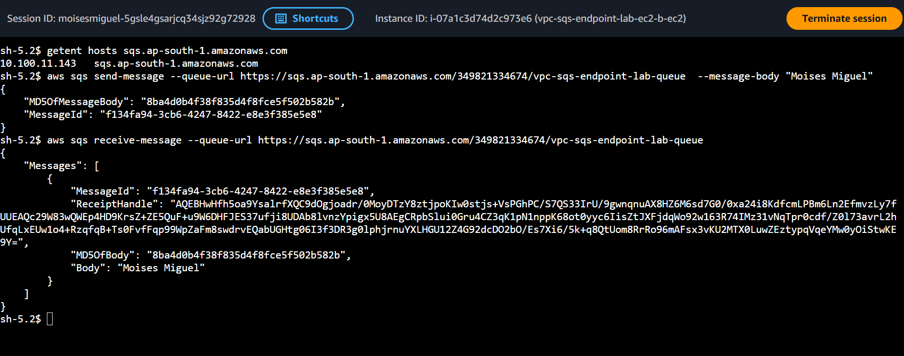

# 6.4 - VPC Interface Endpoint for SQS (with AWS SSM access)

## Architecture
<p align="center">
  
</p>

- VPC-A has an Internet Gateway; EC2-A sits in the public subnet.
- The private subnet has **no Internet Gateway route and no NAT Gateway**.
- An **SQS interface endpoint** (AWS PrivateLink) is created in the private subnet. It places an **ENI** with a private IP in the subnet.
- **Private DNS** is enabled, so `sqs.ap-south-1.amazonaws.com` resolves to the ENI private IP inside the VPC. EC2-B sends and receives messages without leaving the AWS network.
- The endpoint security group allows HTTPS (443) from the VPC CIDR only.
- An SQS queue (SSE enabled) is created. The instance role can send/receive/delete **only on this queue**.

## SSM access (no SSH, no key pairs, no bastion)
- One IAM role with `AmazonSSMManagedInstanceCore` + instance profile, attached to both instances.
- `ssm`, `ssmmessages` and `ec2messages` interface endpoints (private DNS enabled) in the private subnet, so EC2-B registers in SSM without NAT or internet.
- Instances use Amazon Linux 2023 (SSM Agent and AWS CLI preinstalled) with IMDSv2 enforced.

## Interface endpoint vs Gateway endpoint
- **Interface endpoint** (SQS, SSM and most services): an ENI with a private IP, powered by PrivateLink, reached through DNS. Billed per hour per AZ plus data processed.
- **Gateway endpoint** (S3, DynamoDB only): free, works through a route-table entry (prefix list).

## Structure
```
├── main.tf / provider.tf / variables.tf / output.tf
└── module/
    ├── vpc/   (VPC, public/private subnets, IGW, route tables, SSM + SQS interface endpoints)
    ├── ec2/   (instance + security group)
    ├── ssm/   (IAM role + instance profile + SQS access policy)
    └── sqs/   (queue)
```

## Prerequisites
- Terraform >= 1.5 and AWS credentials with permissions for EC2, VPC, IAM, SQS and SSM.
- AWS CLI + Session Manager plugin installed locally.

## Usage
```bash
terraform init
terraform plan
terraform apply
```

## Testing
Wait 2-3 minutes after `apply` so the SSM Agent can register, then:
```bash
# open a session on EC2-B (see the ssm_connect_commands output)
aws ssm start-session --target <ec2-b-id> --region ap-south-1

# inside EC2-B (commands are also in the sqs_test_commands output)
getent hosts sqs.ap-south-1.amazonaws.com      # returns a 10.100.11.x private IP (the endpoint ENI)
aws sqs send-message --queue-url <queue-url> --message-body 'hello from EC2-B' --region ap-south-1
aws sqs receive-message --queue-url <queue-url> --region ap-south-1
```
Always pass `--region ap-south-1` (the AWS CLI has no default region on these instances).

### Prove that the endpoint is the only path
```bash
terraform apply -var="enable_sqs_interface_endpoint=false"
# Inside EC2-B the same aws sqs commands now time out (no route to SQS).
terraform apply    # endpoint back, commands work again
```


## Screenshots
### Download File from Ec2 Instance
<p align="center">
  
</p>


## Cleanup
```bash
terraform destroy
```
