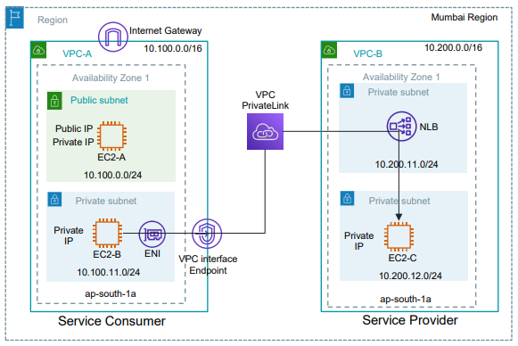

# 6.5 - VPC PrivateLink to SaaS applications (with AWS SSM access)


## Architecture
<p align="center">
  
</p>


Traffic flow:
```
EC2-B -> ENI (interface endpoint) -> AWS PrivateLink -> NLB -> EC2-C
```

- **Provider (VPC-B):** EC2-C runs a small web app (python3 http.server, installed by user data from `assets/saas_app.sh`). An internal **Network Load Balancer** fronts it and is published as a **VPC Endpoint Service**.
- **Consumer (VPC-A):** an **interface endpoint** creates an ENI in the private subnet. EC2-B reaches the service through the endpoint DNS name.
- **No VPC peering, no route between VPC-A and VPC-B, no IGW/NAT in the private subnets.** The consumer can only reach this one service, and the connection is one-way (consumer -> provider). CIDRs could even overlap.
- Same-account lab: the account root is allowed as principal and connection acceptance is off (`acceptance_required = false`). In a real SaaS scenario the provider would be a third party and would accept each connection request.

## SSM access (no SSH, no key pairs, no bastion)
- One IAM role with `AmazonSSMManagedInstanceCore` + instance profile, attached to all 3 instances.
- `ssm`, `ssmmessages` and `ec2messages` interface endpoints (private DNS enabled) in the private subnet of each VPC, so EC2-B and EC2-C register in SSM without NAT or internet.
- Instances use Amazon Linux 2023 (SSM Agent preinstalled) with IMDSv2 enforced.

## Structure
```
├── main.tf / provider.tf / variables.tf / output.tf
├── assets/saas_app.sh        (user data for EC2-C)
└── module/
    ├── vpc/                  (VPC, subnets, IGW, route tables, SSM endpoints)
    ├── ec2/                  (instance + security group)
    ├── ssm/                  (IAM role + instance profile)
    ├── privatelink_provider/ (NLB, target group, listener, endpoint service)
    └── privatelink_consumer/ (interface endpoint + security group)
```

## Prerequisites
- Terraform >= 1.5 and AWS credentials with permissions for EC2, VPC, ELB, IAM and SSM.
- AWS CLI + Session Manager plugin installed locally.

## Usage
```bash
terraform init
terraform plan
terraform apply
```

## Testing
Wait 3-5 minutes after `apply` (SSM Agent registration + NLB health checks), then:
```bash
# open a session on EC2-B (see the ssm_connect_commands output)
aws ssm start-session --target <ec2-b-id> --region ap-south-1

# inside EC2-B (commands are also in the privatelink_test_commands output)
curl -s http://<endpoint_dns_name>:80
# -> Hello from the SaaS provider (EC2-C in VPC-B) - served via AWS PrivateLink ...

# direct access to EC2-C must NOT work (no peering / no route)
curl -s -m 5 http://<ec2-c-private-ip>:80
```

If the first `curl` fails, check the target health:
```bash
aws elbv2 describe-target-health --region ap-south-1 --target-group-arn <tg-arn>
```

## Screenshots
### Testing From Consumer To provider
<p align="center">
  
</p>

## Cost note
Interface endpoints (3 SSM endpoints per VPC + 1 PrivateLink endpoint) and the NLB are billed per hour. Run `terraform destroy` when you finish.

## Cleanup
```bash
terraform destroy
```
