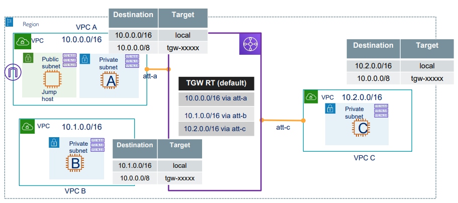
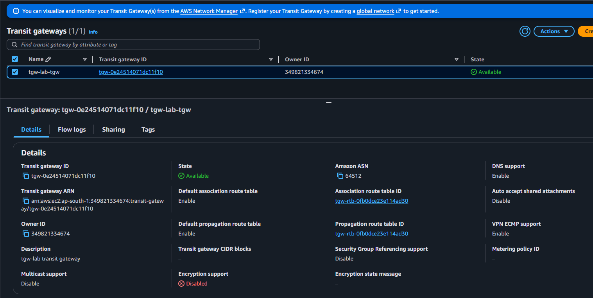
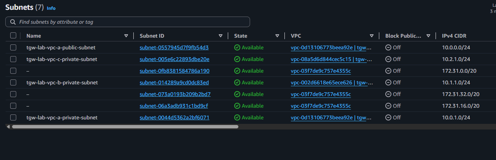
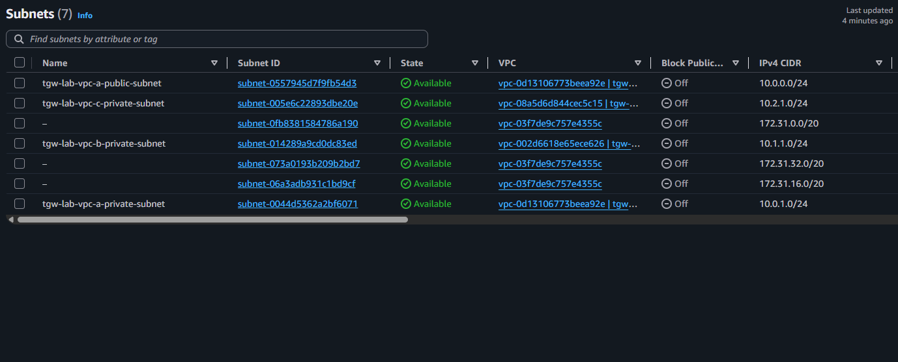
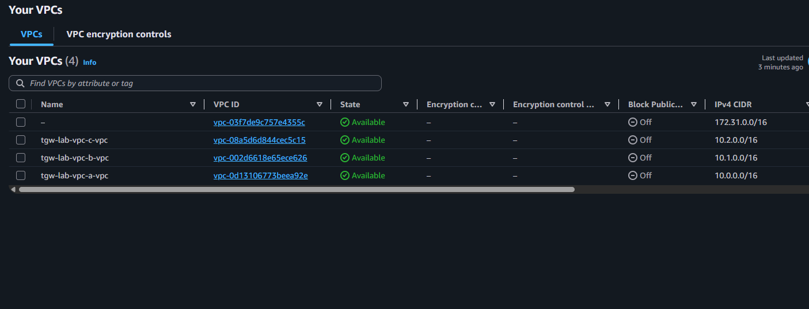
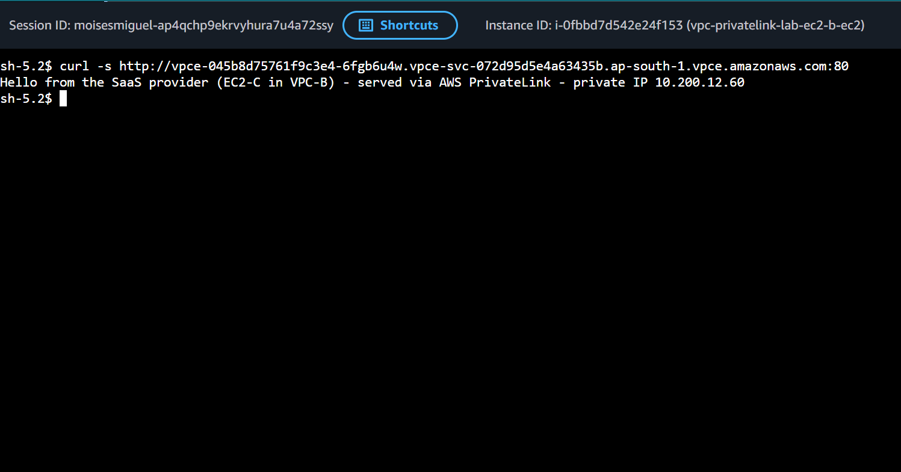

# 6.6 - Transit Gateway: three VPCs with full connectivity (with AWS SSM access)

## Architecture
<p align="center">
  
</p>

- One **Transit Gateway** with three VPC attachments: `att-a`, `att-b`, `att-c`.
- The TGW **default route table** is used: every attachment is *associated* with it and *propagates* its VPC CIDR into it.

| TGW RT (default) | Target |
|------------------|--------|
| 10.0.0.0/16 | att-a |
| 10.1.0.0/16 | att-b |
| 10.2.0.0/16 | att-c |

- Each VPC route table gets one summary route: `10.0.0.0/8 -> tgw-xxxxx` (its own `10.x.0.0/16` stays `local`, because it is more specific). VPC A has it in both its public and private route tables.
- Result: **full connectivity** A <-> B <-> C through a single hub. Unlike VPC peering, there is no need for one connection per pair, and routing is transitive.
- Only VPC A has an Internet Gateway; the private subnets have no IGW and no NAT.
- VPC CIDRs must not overlap (Transit Gateway cannot route overlapping CIDRs).

## SSM access (no SSH, no key pairs, no bastion)
- One IAM role with `AmazonSSMManagedInstanceCore` + instance profile, attached to all instances.
- `ssm`, `ssmmessages` and `ec2messages` interface endpoints (private DNS enabled) in each VPC, so private instances register in SSM without NAT or internet.
- The "jump host" from the diagram is reached with SSM too, so no SSH port is open anywhere.
- Instances use Amazon Linux 2023 (SSM Agent preinstalled) with IMDSv2 enforced. Security groups allow ICMP from `10.0.0.0/8` for testing.

## Structure
```
├── main.tf / provider.tf / variables.tf / output.tf
└── module/
    ├── vpc/   (VPC, public/private subnets, IGW, route tables, SSM endpoints)
    ├── tgw/   (Transit Gateway + VPC attachments)
    ├── ec2/   (instance + security group)
    └── ssm/   (IAM role + instance profile)
```

## Prerequisites
- Terraform >= 1.5 and AWS credentials with permissions for EC2, VPC, Transit Gateway, IAM and SSM.
- AWS CLI + Session Manager plugin installed locally.

## Usage
```bash
terraform init
terraform plan
terraform apply
```

## Testing
Wait 2-3 minutes after `apply` so the SSM Agent can register, then:
```bash
# open a session on the jump host (see the ssm_connect_commands output)
aws ssm start-session --target <jump-host-id> --region ap-south-1

# inside the jump host (commands are also in the connectivity_test_commands output)
ping -c 3 <A private ip>
ping -c 3 <B private ip>
ping -c 3 <C private ip>
```
Repeat from B (ping A and C) and from C (ping A and B) to confirm full connectivity.

Check what the TGW learned (command in the `tgw_routes_command` output):
```bash
aws ec2 search-transit-gateway-routes --region ap-south-1 \
  --transit-gateway-route-table-id <tgw-rt-id> \
  --filters Name=state,Values=active
```
You should see three propagated routes: 10.0.0.0/16, 10.1.0.0/16 and 10.2.0.0/16.

## Cost note
Each TGW attachment is billed per hour plus per GB processed, and each interface endpoint (3 SSM endpoints per VPC = 9) is billed per hour. Run `terraform destroy` when you finish.

## Screenshots
### Transit Gateway
<p align="center">
  
</p>

### Subnets
<p align="center">
  
</p>

<p align="center">
  
</p>

### VPC 
<p align="center">
  
</p>

### Testing Connection
<p align="center">
  
</p>

## Cleanup
```bash
terraform destroy
```
